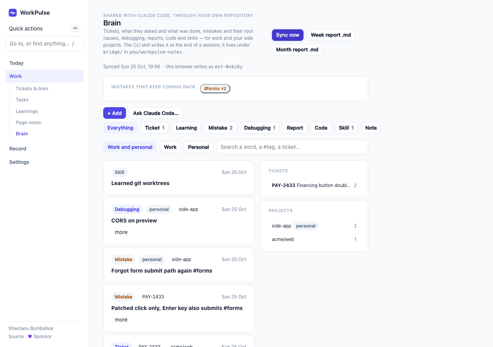
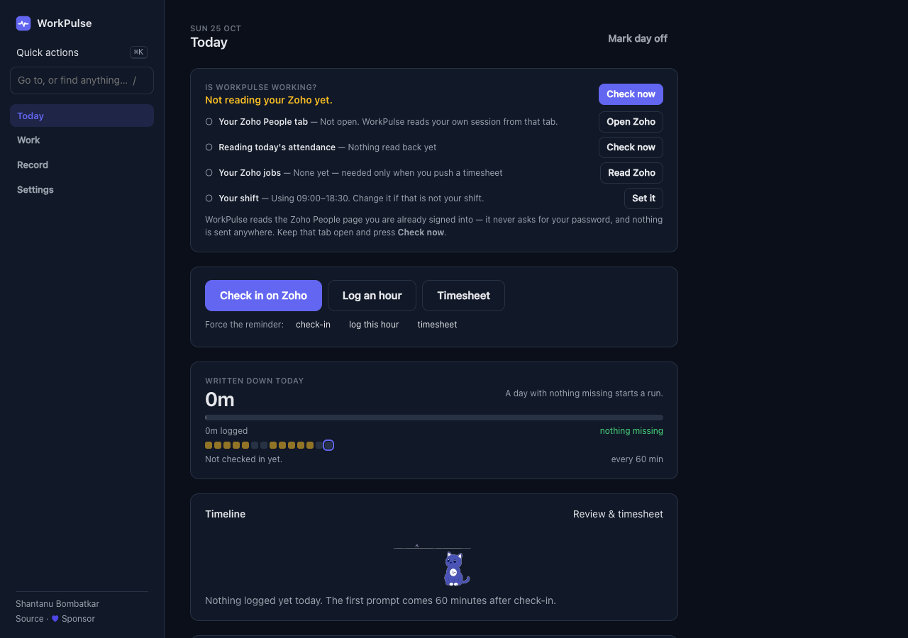

# WorkPulse — the browser extension

A Chrome extension that keeps the record of your workday so you don't have to reconstruct it later: an
hourly "what are you on?" prompt, check-in and wrap-up reminders, breaks, tickets and their links, learnings
and mistakes, a timesheet for Zoho People, and a backup to a private GitHub repository you own.

**No server, no account, no telemetry.** Everything lives in `chrome.storage.local`; the only network calls
are to your own Zoho People session and, if you set it up, to your own GitHub repository.



## What's in this repository

| Folder | What |
|---|---|
| `extension/` | The extension (WXT + React 19 + TypeScript, MV3). `npm run check` runs the typecheck and 1,200+ tests |
| `cli/wp-brain.mjs` | A dependency-free Node CLI that reads and writes the same repository as the extension |
| `skills/workpulse-brain/` | A Claude Code skill that uses the CLI: a brief before each ticket, a record after |
| `src-tauri/fixtures/` | Sample Zoho People API responses (fake values) the extension tests parse |
| `assets/tick/` | The masters of Tick, the cat, 20 six-second clips. `extension/scripts/build-art.mjs` makes the shipped versions |

## Install from source

```bash
cd extension
npm ci
npm run build                 # → extension/.output/chrome-mv3/
```

Open `chrome://extensions`, turn on **Developer mode**, click **Load unpacked**, and pick
`extension/.output/chrome-mv3/`.

## Feature switches

Every newer feature can be left out of a build. Copy `extension/.env.example` to `extension/.env` and set any of
these to `false`, then rebuild:

| Switch | What it removes |
|---|---|
| `WXT_FEATURE_TICK` | Tick on cards, empty pages and busy strips |
| `WXT_FEATURE_BRAIN` | The Brain page |
| `WXT_FEATURE_BRIDGE_SYNC` | Reading and writing `bridge/` in your backup repository |
| `WXT_FEATURE_PERSONAL` | Personal side projects in the Brain |
| `WXT_ENABLE_API=true` | (opt-in) The official Zoho People API path, for orgs that grant API access |

## The Brain: the extension and Claude Code share one repository

The backup repository you choose in **Settings → Backup** gets a `bridge/` folder. The extension and the CLI both
read it and each writes only its own file, so nothing conflicts:

```
bridge/entries/<YYYY-MM>/<device>.jsonl   tickets, mistakes, debugging, reports, code, skills, notes
bridge/inbox/to-cli/*.json                requests from the extension ("plan PAY-123")
bridge/inbox/acks/<device>/*.json         the CLI saying it picked one up
```

- The extension polls with a conditional request (an unchanged repository costs a free `304`): every minute while
  the Brain page is open, every 15 minutes otherwise, and on **Sync now**.
- The CLI uses your own git login (`gh` or SSH). It never sees the extension's token.
- Anything shaped like a credential (GitHub, OpenAI/Anthropic, Stripe, Supabase, AWS, Slack tokens, private keys,
  JWTs) is refused on both sides.

**Linking, step by step:** in the extension, Settings → Backup (token, repository, branch; the first backup is
always pressed by hand), then Settings → **Claude Code & the Brain**, which shows the state of the link and the
commands to copy. On each machine where you use Claude Code:

```bash
node cli/wp-brain.mjs setup     # asks: repository, branch, device, brief hook, record hook, global rule, skill — then installs
node cli/wp-brain.mjs doctor    # checks every part of the link
```

Or by hand:

```bash
node cli/wp-brain.mjs init you/your-private-notes-repo      # once per machine (Node ≥ 22.18)
node cli/wp-brain.mjs init you/a-private-repo --branch brain  # or: a branch of a repo you already have
node cli/wp-brain.mjs brief PAY-2433                        # before a ticket
node cli/wp-brain.mjs add mistake "Patched one path #forms" --ticket PAY-2433 --root-cause "…"
node cli/wp-brain.mjs add --json - < session.json           # a whole ticket at the end
node cli/wp-brain.mjs report --days 7                       # week report, Markdown
```

In the extension, Brain entries also show on the **Learnings** page (and count towards "keeps coming back"),
and on each ticket's page; an entry whose ticket is not saved yet has **+ new ticket**.

Two optional Claude Code hooks make it automatic:

| Hook | Command | Effect |
|---|---|---|
| SessionStart | `node /path/to/cli/wp-brain.mjs hook` | The brief for the branch's ticket (`fix/pay-2433-…`) and repo, as context; silent when nothing is recorded |
| Stop | `node /path/to/cli/wp-brain.mjs stop-check` | Once per session, after a commit on a ticket branch with nothing recorded, asks Claude to record the session |

The brief also reads what you wrote on the extension's Learnings page, from its daily backup on the same branch.

To use the Claude Code skill, link it into your skills folder and set the path to `cli/wp-brain.mjs` in
`SKILL.md`:

```bash
ln -s "$PWD/skills/workpulse-brain" ~/.claude/skills/workpulse-brain
```

## Tick

Tick, the cat, appears on every reminder card, every empty page, and while a backup, push or page read is
running.



The clips are cut out of `assets/tick/NN-slot.mp4` by `node extension/scripts/build-art.mjs`. That needs `ffmpeg`
with libvpx-vp9, and `python3` with `numpy` and `opencv-python`. Each slot ships as a 320 px, 6-second VP9 loop
with real transparency (`.webm`) plus a transparent still (`.webp`): 1.4 MB for all 20. Only the backdrop
connected to the frame edge is removed, so Tick's white belly and eyes stay solid on a dark card.

A missing file shows nothing rather than a broken image, and reduced motion gets the still. The slot brief is in
[`DESIGN.md`](DESIGN.md).

Breaks include eyes (20-20-20), standing up, water, posture and a minute of slow breathing. Each is off by
default and set in **Settings → Breaks**.

## Contributing

See [CONTRIBUTING.md](CONTRIBUTING.md). Decisions live in `extension/src/core/` as pure functions with tests;
run `npm run check` in `extension/` before a pull request.

## Licence

MIT. See [LICENSE](LICENSE).
