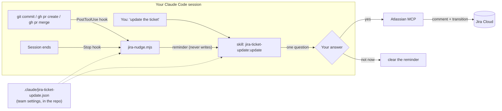
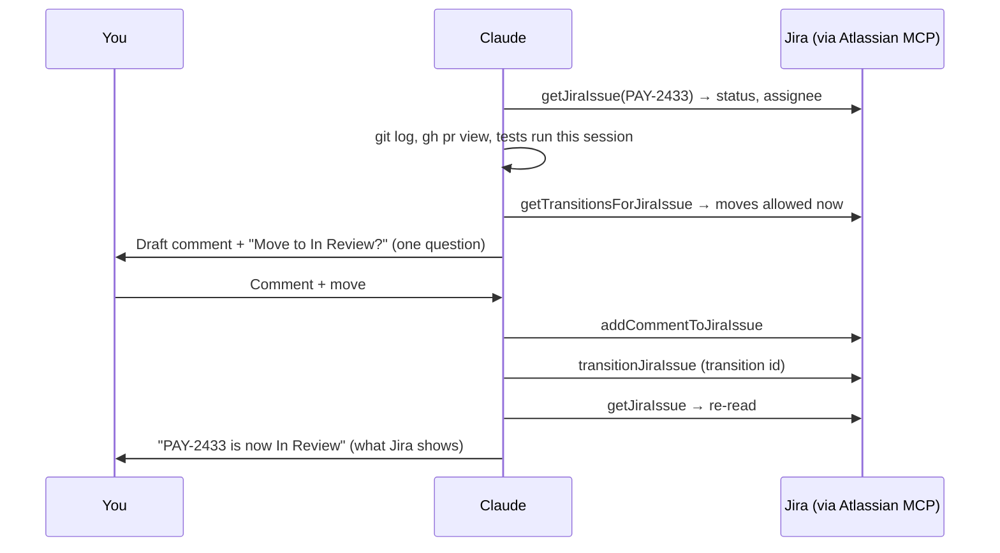

# Jira Ticket Update: what it is, how it works, how to set it up

Updated: 2026-10-27
What this is for: the one explainer for the `jira-ticket-update` Claude Code plugin. It covers the problem,
what changes for you, the full flow, setup for one person, a team or another machine, the settings, and
troubleshooting. Share this file with anyone who'll use it.
Related: plugin source [`plugins/jira-ticket-update/`](../../plugins/jira-ticket-update/) ·
[plugin README](../../plugins/jira-ticket-update/README.md)

> **State, 2026-10-27:** **v0.2.0** (setup offered automatically, one question, works before any setup); v0.1.0 released in the public `workpulse` marketplace
> ([release](https://github.com/myind-ai/workpulse-extension/releases/tag/jira-ticket-update-v0.1.0)). Checked:
> 4 script tests pass and `claude plugin validate` passes for the plugin and the marketplace.
> **Not yet run against a live Jira**, so tell us what the first real update does.

---

## 1. The problem

The work moves and the ticket doesn't.

- You open the PR, and Jira still says **In Progress**.
- It's merged and on stage, and QA never picks it up because it never reached **Ready for QA**.
- Someone asks in standup "is PAY-2433 done?", and the board can't answer.
- At sprint end you close six tickets in one go, from memory, with no useful comment on any of them.

Updating a ticket isn't hard. It's **forgettable**: it happens at the moment your attention is on the next thing.

## 2. What it does

Claude Code already sees the moments that should move a ticket: your commits, the PRs you open and merge,
and the end of your session. The plugin uses those moments to **write the update for you and ask once**.

| Before | With the plugin |
|---|---|
| You remember (or don't) to open Jira after the PR | Right after `gh pr create`, Claude offers: *comment + move PAY-2433 to In Review?* |
| Comments like "done" or none at all | A factual comment: PR link, commits, what was tested, stage link, next step |
| Status names guessed | Only moves your workflow actually allows from the current status |
| Tickets forgotten at the end of the day | When the session ends, one question covers every ticket touched |
| Each person sets up tokens and config | Two install commands and one sign-in; the team's settings come with `git pull` |

**What it never does:** it never writes to Jira without your "yes" for that ticket, never puts secrets, code or
logs in a comment, and never invents a status name.

## 3. The overall flow

### The pieces



| Piece | Job | Talks to Jira? |
|---|---|---|
| **Hook script** `jira-nudge.mjs` | Spots commits and PRs on a ticket branch or message; reminds Claude at the right moment; offers setup once in a repo that needs it | **No** |
| **Skill** `jira-ticket-update:update` | Reads the ticket, gathers facts, drafts the comment and move, asks, then does it | Yes, after your yes |
| **Skill** `jira-ticket-update:setup` | One question: site, prefixes and which transition means what, all detected or guessed | Reads only |
| **Atlassian MCP server** | Your own Atlassian login (OAuth in the browser); no token to create | It's the Jira access |
| **Team file** `.claude/jira-ticket-update.json` | Prefixes and status mapping, committed once | n/a |

The key design choice: **the trigger and the write are separate.** A hook can only remind; the write happens
only inside the skill, after you answer. A bug in a reminder can never change Jira.

### What triggers it

| You do | What happens | When |
|---|---|---|
| Say "update the ticket", "move PAY-123 to review", "close it", "comment on PAY-123" | The full flow for that ticket | Now |
| `gh pr create` on a ticket branch or with the key in the title | Claude offers the **PR opened** move | Right after the PR |
| `gh pr merge` | Claude offers the **PR merged** move | Right after the merge |
| `git commit` on `feature/PAY-123-…` or with the key in the message | Noted silently, no interruption | Offered at session end |
| End the session with ticket work not reported | **One** question covering all those tickets | Once per session, never twice |
| Say "start PAY-123" while it's still To Do | Claude offers the **started** move | Now |

Where the ticket key comes from: your words first, then the commit message or PR title, then the branch name.
If there's no key, it asks; it never guesses.

### One update, step by step



1. **Read the ticket.** If it's already at or past the target, Claude says so and stops: no comment just for the sake of it.
2. **Gather facts:** the branch's commits, the PR link and state, the tests that ran *in this session* and their results, and any stage link you mentioned.
3. **Pick the move** from the team mapping (for example, *PR opened → Code Review*), then check it's allowed from the current status. If not, it offers the moves that are.
4. **Ask once**, with the comment shown in full. The choices are **Comment + move** (recommended), **Comment only**, **Move only** and **Not now**.
5. **Do it, re-read, report** the status Jira actually shows.

### What a comment looks like

```
Update — retry now backs off on 502s instead of failing the payment

• PR: https://github.com/acme/pay/pull/42 (open)
• Commits: 3 — retry with jittered backoff; cap at 3 attempts; log attempt count
• Tested: unit tests 214 passing | Not tested: against the stage gateway
• Stage: —
• Next: review from the payments team, then QA on stage
```

It contains facts only. "Tested" lists only what actually ran. There are no secrets, `.env` values, customer data,
stack traces or code, and no mention of AI.

### An example session

```
you     › gh pr create --title "PAY-2433 retry on 502" …
claude  › PR opened for PAY-2433. Jira shows it In Progress. Here's the update:
          [comment preview]
          ◉ Comment + move to Code Review (recommended)
          ○ Comment only   ○ Move only   ○ Not now
you     › Comment + move to Code Review
claude  › Commented and moved. Jira now shows PAY-2433: Code Review.
```

---

## 4. Setup

### Each person: about two minutes

1. **Install the plugin** (in Claude Code):

   ```
   /plugin marketplace add myind-ai/workpulse-extension
   /plugin install jira-ticket-update@workpulse
   ```

   On Claude Code 2.1.275 or later, one line does both:

   ```
   /plugin install jira-ticket-update --marketplace myind-ai/workpulse-extension
   ```

2. **Sign in to Atlassian**: the one step only a person can do.

   ```
   /mcp
   ```

   Pick **atlassian** and approve it in the browser with your Atlassian account. If you already use the
   **claude.ai Atlassian** connector, that works too; the plugin uses whichever is signed in.

3. **Done. Just work.** No setup is needed to start:
   - in a repo whose history uses ticket keys and has no settings yet, Claude offers the one-question setup
     **itself**, once, after your first request;
   - or skip it: at your first PR, Claude guesses the right status from your workflow's names, asks once, and
     remembers your answer.

Nothing goes in `settings.json` by hand: the hooks, skills and MCP server come with the plugin.

### The team: one person, one question

When Claude offers it (or you say **"set up jira ticket updates"**), it works everything out without asking:
- the Jira site (it asks only if you have several);
- the ticket prefixes, from the repo's commits and branches (`PAY`, 14 tickets);
- which real transition means **started**, **PR opened**, **PR merged**, **on stage** and **done**, guessed from
  your workflow's names (*Code Review*, *Ready for QA* …). It never skips backwards moves like *Reopen* or *Block*
  silently; it just never picks them.

Then **one question** shows the whole proposal:

| Choice | What it writes |
|---|---|
| **Save for the team + offer the plugin to teammates** (recommended) | `.claude/jira-ticket-update.json` and the repo's `.claude/settings.json` block below, committed |
| Save for the team | the team file only |
| Just for me | your personal file, with no repo changes |
| Change something | asks only about the part you name |

With the recommended choice, a teammate who opens the repo is offered the plugin by Claude Code (after trusting
the folder), already set up. They only sign in with `/mcp`. The block it adds to the repo's `.claude/settings.json`:

```json
{
  "extraKnownMarketplaces": {
    "workpulse": { "source": { "source": "github", "repo": "myind-ai/workpulse-extension" } }
  },
  "enabledPlugins": { "jira-ticket-update@workpulse": true }
}
```

**Clicks, end to end:** the first person installs (1 command), signs in (`/mcp`, then approve in the browser),
answers 1 question, and commits. Each teammate accepts the plugin and signs in.

### Another machine of yours

Same as "each person": install, then `/mcp` → sign in. Repo settings come from the repo. Personal settings
(for repos without a team file) are per machine, so run `set up jira ticket updates` once there if you need them.

### Try it without installing

From a clone of `myind-ai/workpulse-extension`:

```bash
claude --plugin-dir ./plugins/jira-ticket-update
```

This loads the plugin for that one session only.

---

## 5. Settings reference

Two files, merged; **the team file wins.**

| File | Who writes it | Committed? |
|---|---|---|
| `<repo>/.claude/jira-ticket-update.json` | the team, through `setup` | **Yes.** No secrets in it |
| `${CLAUDE_PLUGIN_DATA}/config.json` (`~/.claude/plugins/data/…`) | you, for repos with no team file | No (per machine; survives plugin updates) |

```json
{
  "site": "https://yourco.atlassian.net",
  "cloudId": "…",
  "prefixes": ["PAY", "LEAP"],
  "projects": {
    "PAY": {
      "moves": {
        "started": "Start Progress",
        "pr_opened": "Code Review",
        "pr_merged": "Ready for QA",
        "deployed_stage": "Ready for QA",
        "done": "Done"
      },
      "commentFooter": ""
    }
  }
}
```

| Key | Meaning |
|---|---|
| `site`, `cloudId` | Which Jira. Not credentials: sign-in stays per person in `/mcp` |
| `prefixes` | Which keys count. Keeps `UTF-8` or `SHA-256` from looking like tickets. Empty = any `ABC-123` except common look-alikes |
| `projects.<PREFIX>.moves` | Event → the **exact transition name** in that project's workflow. A missing event means Claude asks |
| `commentFooter` | Optional line added to every comment (for example, a team tag) |

See what applies in the current repo:

```bash
node "$(ls -d ~/.claude/plugins/cache/*/jira-ticket-update/*/scripts | tail -1)/jira-nudge.mjs" config
```

---

## 6. Safety rules (built into the skill)

| Rule | Why |
|---|---|
| No Jira write without a yes **for that ticket** | A comment is public to your team; one yes doesn't carry to the next ticket |
| Hooks only remind; only the skill writes | A reminder bug can't change Jira |
| Comments are facts only; "tested" means it ran in this session | The ticket is read by your PM, QA and manager |
| No secrets, `.env` values, customer data, stack traces, code or AI mentions | Same reason |
| Transitions come from Jira's own list for the current status | Workflows differ; an invented name fails or moves the wrong way |
| Re-read after moving and report what Jira shows | "I asked for In Review" isn't the same as "it is In Review" |
| Asks once at session end, never twice | A reminder that nags gets turned off |
| A transition that needs fields (resolution, fix version) | Claude asks for the value; it never fills defaults |

---

## 7. Troubleshooting

| You see | Cause | Fix |
|---|---|---|
| "Atlassian isn't signed in" / only `authenticate` tools | Not signed in on this machine | `/mcp` → atlassian → sign in |
| `Plugin "jira-ticket-update" not found in marketplace "workpulse"` | The marketplace was never added on this machine, or was added before this plugin existed | `/plugin marketplace add myind-ai/workpulse-extension` (never added) or `/plugin marketplace update workpulse` (added earlier), then install again |
| Two Atlassian servers in `/mcp` | You also have the claude.ai connector | Either works; disable one in `/mcp` if you like |
| No reminder after a PR | No ticket key in the branch or title, or the prefix isn't in `prefixes` | Name branches `feature/PAY-123-…`, or add the prefix (`setup`) |
| A reminder for `UTF-8` / `SHA-256` | No `prefixes` set | Run `setup`, or add `prefixes` to the team file |
| "That move isn't available from In Progress" | The workflow needs two hops (In Progress → Review → QA) | Claude offers the next allowed move; each hop is its own yes |
| Comment shows raw `*` or `•` | The MCP may want Markdown or ADF | Tell Claude; the skill's gotchas table records the format once it's known |
| It keeps asking at session end | It shouldn't (once per session) | Run the script's `list` command and check `pending.json` in the plugin data folder |
| A skill triggers twice | The old personal copy is still installed | Delete `~/.claude/skills/jira-ticket-update/` and any hand-pasted `jira-nudge` hooks in `settings.json` |

Useful commands (the script never calls Jira):

```bash
NUDGE="$(ls -d ~/.claude/plugins/cache/*/jira-ticket-update/*/scripts | tail -1)/jira-nudge.mjs"
node "$NUDGE" config        # settings in effect here
node "$NUDGE" list          # ticket events waiting for an update
node "$NUDGE" clear PAY-123 # forget the pending reminder for one ticket
```

---

## 8. FAQ

**Does it need a Jira API token?** No. You sign in with your own Atlassian account through `/mcp` (OAuth).
Nothing is stored in the repo.

**Can it change tickets on its own?** No. Every write follows a yes for that ticket in the conversation.

**What about tickets I touch outside Claude Code** (hours logged, a stage link saved in the browser)? That's the
WorkPulse-extension side, still being planned.

**Jira Server / Data Center?** Not supported: the Atlassian MCP server is for Jira Cloud.

**Uninstall?** `/plugin uninstall jira-ticket-update@workpulse`. The team file stays in the repo until you delete it.

---

## 9. Files in the plugin

| Path | What |
|---|---|
| `.claude-plugin/plugin.json` | Name, version, description, privacy link |
| `.mcp.json` | The Atlassian MCP server (`https://mcp.atlassian.com/v1/mcp/authv2`) |
| `hooks/hooks.json` | SessionStart (offer setup once), PostToolUse (Bash) and Stop hooks → `scripts/jira-nudge.mjs` |
| `scripts/jira-nudge.mjs` | Spots commits and PRs, keeps the pending list, detects prefixes, guesses the status mapping, reads and writes settings. Never calls Jira |
| `scripts/jira-nudge.test.mjs` | `node --test plugins/jira-ticket-update/scripts/jira-nudge.test.mjs` |
| `skills/update/SKILL.md` | The ask → comment → move flow |
| `skills/setup/SKILL.md` | One-time team setup |

## Publishing for teammates

The install commands read the marketplace from GitHub at `myind-ai/workpulse-extension` (public). A new
plugin version is published by bumping `version` in `plugins/jira-ticket-update/.claude-plugin/plugin.json`
and pushing; people get it with `/plugin marketplace update workpulse`. Its GitHub release is tagged
`jira-ticket-update-vX.Y.Z` and is **never marked "latest"**, because the WorkPulse extension and `update.sh` read the
latest release as the extension's version.

## What changed

- **2026-10-27:** this file was the "paste two hooks into settings.json" guide for a personal skill
  (`~/.claude/skills/jira-ticket-update/`). It's now the full explainer for the plugin, which bundles the hooks,
  skills and MCP server, with team settings in a committed repo file. The personal copy is superseded.
- **2026-10-27:** released v0.1.0 to the public marketplace.
- **2026-10-27, 0.2.0:** setup went from 5–7 questions to one. Prefixes are detected and the status mapping is guessed, setup is offered automatically once per repo, updates work before any setup (guess, ask once, remember), the script writes the settings, and the recommended choice also makes the repo offer the plugin to teammates.
